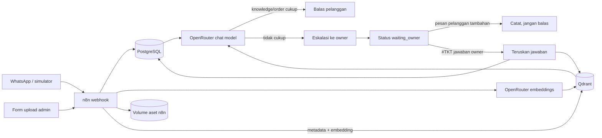

# Simplified CS Bot

Chatbot customer service WhatsApp untuk SaViOr konveksi, berbasis n8n + OpenRouter.

Proyek ini menyediakan chatbot admin WhatsApp berbahasa Indonesia yang dapat:

- mengambil dan meringkas order melalui perintah owner;
- menjawab pelanggan dari knowledge Qdrant dan meniru gaya chat owner;
- mempelajari gaya serta FAQ dari WhatsApp Chat Export;
- menerima upload aset gambar dan mengirim referensi yang relevan ke pelanggan;
- mengeskalasi pertanyaan yang tidak didukung knowledge;
- **tidak membalas pelanggan** selama menunggu owner;
- meneruskan jawaban owner apa adanya, lalu menyimpannya sebagai knowledge baru.

Service bot (aplikasi pendukung SaViOr) berjalan dari `compose.yaml` di folder ini. Database PostgreSQL **tidak** ada di
sini: bot memakai database milik aplikasi web SaViOr (`../GitHub/savior-app/compose.yaml`,
container `savior-postgres`). Skema bot (`bot`, `bot_api`, `n8n_internal`) disimpan di
database `savior`, dimiliki role `wa_admin`.

Data bot hanya dua tabel (`db/001-schema.sql`):

- `bot.tickets`: pertanyaan yang dieskalasi ke owner (nomor & nama pelanggan, pertanyaan,
  jawaban owner, status `waiting_owner` → `owner_replied` → `resolved`).
- `bot.orders`: order pelanggan (nomor & nama pelanggan, item, total, resi, status).

Keputusan balas/eskalasi dibuat model AI di workflow; database hanya membuka tiket saat
model memilih eskalasi (`bot_api.open_ticket`). Knowledge disimpan di Qdrant saja, dan
riwayat chat tidak disimpan. Skema lama ada di `legacy/db/`.

| Service | URL | Isi |
|---|---|---|
| n8n | http://localhost:5678 | workflow chatbot; semua data n8n (SQLite, credential, aset) di folder `./n8n_data` |
| wa-dashboard | http://localhost:4000 | dashboard tiket & order bot WhatsApp |
| db-api | 127.0.0.1:3002 | PostgREST untuk skema `bot_api`, terhubung ke `savior-postgres` lewat jaringan `savior-app_default` |
| qdrant | 127.0.0.1:6333 | vector DB knowledge (`/dashboard`) |
| mock-whatsapp | 127.0.0.1:8080 | gateway WhatsApp tiruan untuk uji lokal |
| tunnel | https://`NGROK_DOMAIN` (inspector 127.0.0.1:4040) | ngrok ke n8n untuk webhook Meta, aktif dengan `COMPOSE_PROFILES=tunnel` |

Aplikasi utama SaViOr berjalan dari compose-nya sendiri (`../GitHub/savior-app`):
`savior-web` (http://localhost:3500) dan `savior-postgres` (port 5433). Stack ini hanya
pendukung dan tidak menjalankan aplikasi SaViOr.

Semua model AI (chat dan embedding) dipakai lewat OpenRouter (`OPENROUTER_*` di `.env`);
tidak ada model lokal yang perlu dijalankan.
Setup lama (n8n terpisah + `compose.yaml` pendukung) disimpan di `legacy/`.

## Deploy ke mesin baru

```bash
git clone <savior-app> ../GitHub/savior-app
(cd ../GitHub/savior-app && docker compose up -d)   # SaViOr web + database
cp .env.example .env                                # isi semua nilai ganti_..., NGROK_*
make db-init                                        # sekali: role + skema bot di database SaViOr
make up                                             # n8n, PostgREST, Qdrant, dashboard tiket, tunnel
```

Langkah lengkap setelah `make up` (cek service, credential n8n, knowledge, webhook Meta, uji):
[docs/AFTER-UP.md](docs/AFTER-UP.md).

Pindahkan data dari mesin lama: salin folder `n8n_data/` (workflow, credential, aset),
lalu pulihkan hasil `make backup` (`postgres-all.sql.gz` ke `savior-postgres` sebagai ganti
`make db-init`, snapshot Qdrant lewat `PUT /collections/<nama>/snapshots/upload`).
`N8N_ENCRYPTION_KEY` harus sama dengan mesin lama agar credential n8n tetap terbaca.

- `make backup`: dump database SaViOr (termasuk skema bot), snapshot Qdrant, dan arsip
  `n8n_data` ke `backups/stack_<waktu>/` tanpa menghentikan service.
- `make db-migrate FILE=db/00x-....sql`: terapkan file SQL bot baru ke database yang sudah ada.
- `make db-move`: memindahkan data bot dari postgres lama stack ini (sebelum database
  digabung ke SaViOr). Tanpa `CONFIRM=ya` hanya cek + backup.
- Tunnel: hentikan `ngrok` di host sebelum menyalakan service `tunnel`, karena satu domain
  ngrok hanya boleh dipakai satu agent.

## Alur sistem



Keputusan AI memakai pola *fail closed*: apabila output model rusak, context tidak cukup,
atau knowledge/order tidak mendukung jawaban, sistem memilih eskalasi.

## Mulai cepat

Prasyarat: Docker Desktop, Node.js 20+, dan API key OpenRouter.

1. Buat konfigurasi lokal:

   ```bash
   cp .env.example .env
   ```

   Ganti semua nilai `ganti_...`, isi `OWNER_PHONE`, dan pilih ID model yang benar.
   Jangan commit `.env`.

2. Isi `OPENROUTER_API_KEY` (https://openrouter.ai/keys). Model bawaan pada `.env.example`:

   - chat: `nvidia/nemotron-3-super-120b-a12b` (`OPENROUTER_MODEL`);
   - embedding: `openai/text-embedding-3-small` (`OPENROUTER_EMBEDDING_MODEL`).

   Mengganti model embedding mengubah dimensi vector, jadi buat collection baru dengan
   `node scripts/reembed-knowledge.mjs <collection_lama> <collection_baru>` lalu ubah
   `QDRANT_COLLECTION` (dan cek ulang `QDRANT_SCORE_THRESHOLD`).

3. Jalankan database SaViOr lebih dulu, siapkan skema bot, lalu jalankan stack:

   ```bash
   (cd ../GitHub/savior-app && docker compose up -d)
   make db-init  # sekali untuk database SaViOr baru
   make up
   make import   # opsional: timpa workflow dengan workflows/wa-admin-lengkap.json
   ```

4. Buka `http://localhost:5678`, buat akun owner, lalu isi credential
   "WhatsApp account" dan "OpenAI account". Jalankan manual
   `WA Admin 00 - Inisialisasi Qdrant` satu kali jika collection belum tersedia.

Perintah lain: `make ps`, `make logs`, `make restart`, `make down`.

Dashboard Qdrant tersedia secara lokal di `http://localhost:6333/dashboard`.
Collection yang dipakai workflow adalah `QDRANT_COLLECTION` (saat ini `wa_knowledge_openrouter`, embedding OpenRouter; `wa_knowledge` lama berisi embedding LM Studio dan tidak dipakai lagi).

## Uji lokal tanpa Meta

Tambahkan order contoh:

```bash
node scripts/upsert-order.mjs samples/order.json
```

Kirim pesan pelanggan:

```bash
node scripts/simulate-inbound.mjs customer 628111111111 "Pesanan saya sudah dikirim belum?"
```

Minta ringkasan order sebagai owner:

```bash
node scripts/simulate-inbound.mjs owner "$OWNER_PHONE" "/pesanan hari_ini"
```

Lihat pesan keluar yang ditangkap gateway mock:

```bash
curl http://localhost:8080/messages
```

Untuk menguji eskalasi, kirim pertanyaan yang tidak ada di knowledge. Ambil kode
`#TKT-XXXXXXXX` dari pesan ke owner, lalu:

```bash
node scripts/simulate-inbound.mjs owner "$OWNER_PHONE" "#TKT-XXXXXXXX Jawaban yang diteruskan persis ke pelanggan"
```

## Impor gaya chat dan knowledge

Ekspor chat WhatsApp sebagai `.txt` tanpa media. Nama owner harus sama persis dengan
nama pengirim pada log.

```bash
node scripts/import-chat-export.mjs samples/whatsapp-export.txt "Owner"
```

Workflow menganalisis gaya owner, mengambil hanya pasangan tanya/jawab yang terlihat
jelas, menyimpan profil gaya di PostgreSQL, dan meng-upsert FAQ ke Qdrant. Data sensitif
seperti OTP dan nomor rekening secara eksplisit diminta untuk diabaikan oleh prompt;
tetap tinjau data sebelum mengimpor log produksi.

## Upload file dari form n8n

Setelah workflow dipublish, buka:

```text
https://estimate-nearest-decent.ngrok-free.dev/form/admin-upload-knowledge
```

Form memakai autentikasi akun n8n, sehingga pengguna harus login. Pilih salah satu tipe:

- `text`: upload `.txt` hasil Export chat WhatsApp. Nama owner default `Savior` dan
  dapat diedit agar sama persis dengan nama pengirim di log. File mentah hanya dibaca
  selama eksekusi; profil gaya disimpan ke PostgreSQL dan Q&A ke Qdrant.
- `image`: upload JPG, PNG, atau WEBP maksimal 15 MB. Isi deskripsi yang spesifik dan
  tag yang relevan. File asli disimpan persisten di volume `n8n_data/assets`, sedangkan
  embedding deskripsi serta metadata/path-nya disimpan di Qdrant.

Ketika pelanggan meminta gambar referensi, router mencari knowledge dan aset dalam
collection yang sama. Aset hanya dikirim jika model memilih `asset_id` yang benar-benar
ada pada hasil pencarian; jika tidak ada yang relevan, pertanyaan dieskalasi ke owner.

Untuk otomatisasi, endpoint yang sama juga tersedia sebagai API multipart:

```bash
curl -X POST "$N8N_PUBLIC_URL/webhook/admin/upload-knowledge" \
  -H "x-import-key: $IMPORT_API_KEY" \
  -F "data_type=image" \
  -F "description=referensi kaos panitia warna tosca" \
  -F "tags=kaos,panitia,tosca" \
  -F "file=@./referensi.png"
```

Untuk chat, ganti `data_type=text`, tambahkan `owner_name=Savior`, dan upload file `.txt`.

## Dashboard admin

Dashboard NodeJS tersedia di `http://localhost:4000` (service `wa-dashboard` pada
compose, tanpa dependency eksternal). Fitur:

- **Follow-up tiket** — inbox tiket (cari + filter) dengan tampilan percakapan, ringkasan
  kebutuhan (AI), dan kotak balasan. *Kirim* meneruskan jawaban ke pelanggan lewat
  webhook n8n `dashboard-send` (workflow utama, credential "WhatsApp account", dilindungi
  `DASHBOARD_SEND_SECRET`). Tiket baru ditandai selesai dan Q&A disimpan ke knowledge
  setelah WhatsApp mengembalikan ID pesan; bila gagal, tiket tetap terbuka dan error
  ditampilkan. Tiket selesai punya tombol *Kirim ulang jawaban*. Patch workflow:
  `node scripts/apply-dashboard-send.mjs <in.json> <out.json>`. Gateway mock hanya dipakai
  dengan `WA_SEND_MODE=mock`.
- **Ringkasan order per tanggal** — perbandingan order (judul item, pcs, tipe item,
  nilai) antara tanggal terpilih dan hari sebelumnya.
- **Total order bulan berjalan** — total order per tanggal, termasuk jumlah yang
  dikonfirmasi pelanggan (ada pesan pelanggan setelah order) dan nilai rupiahnya.

Ikut berjalan dengan `make up`. Database SaViOr baru disiapkan dengan `make db-init`
(memuat semua file `db/*.sql`); file SQL baru diterapkan dengan `make db-migrate FILE=...`.

## Perintah owner

| Perintah | Fungsi |
|---|---|
| `/pesanan` | Ringkasan order hari ini |
| `/pesanan hari_ini` | Sama dengan `/pesanan` |
| `/pesanan 628xxx` | Ringkasan order nomor pelanggan |
| `/pesanan semua` | Ringkasan maksimal 100 order terbaru |
| `#TKT-XXXXXXXX jawaban` | Teruskan bagian `jawaban` ke pelanggan |

Selama tiket berstatus `waiting_owner` atau `owner_replied`, setiap pesan tambahan
pelanggan hanya disimpan. Tidak ada pesan tunggu otomatis yang dikirim.

## Workflow

Seluruh sistem didefinisikan dalam satu file:
`workflows/wa-admin-lengkap.json`.

Di canvas n8n, setiap kelompok dilengkapi Sticky Note berbahasa Indonesia:

1. `00 — Inisialisasi Qdrant`
2. `01 — Verifikasi Webhook Meta`
3. `02 — Router Utama WhatsApp`
4. `03 — Impor Chat & Gaya Owner`
5. `04 — Sinkronisasi Order`
6. `05 — Upload Knowledge & Aset`

Bagian upload text memakai kembali parser pada alur 03; bagian lain dimulai oleh trigger
masing-masing. Semuanya berada dalam satu workflow agar hubungan antarfitur mudah dibaca. Workflow JSON dibuat
dari `scripts/generate-workflows.mjs`. Setelah mengubah generator, jalankan
`make generate`, `make validate`, lalu impor ulang workflow hasilnya.

## Produksi

Untuk beralih dari mock ke WhatsApp Cloud API, ikuti [docs/SETUP-META.md](docs/SETUP-META.md).
Kontrak order, operasi tiket, tuning threshold, dan checklist privasi ada di
[docs/OPERASIONAL.md](docs/OPERASIONAL.md).

Dokumentasi rujukan:

- [OpenRouter API](https://openrouter.ai/docs)
- [n8n Docker](https://docs.n8n.io/hosting/installation/docker/)
- [n8n SSRF protection](https://docs.n8n.io/hosting/securing/ssrf-protection/)
- [WhatsApp Cloud API](https://developers.facebook.com/docs/whatsapp/cloud-api/)
